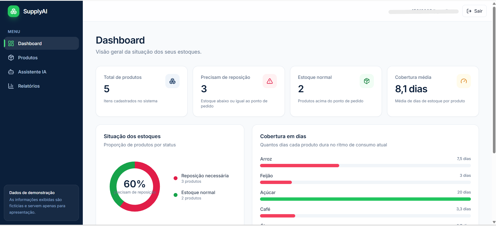
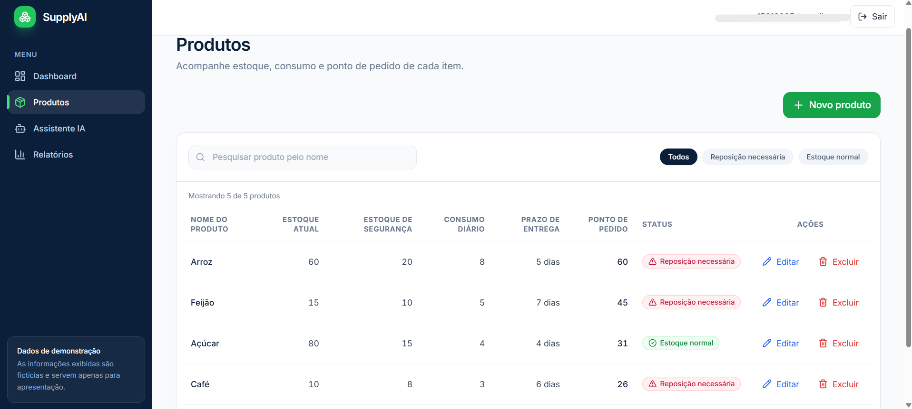
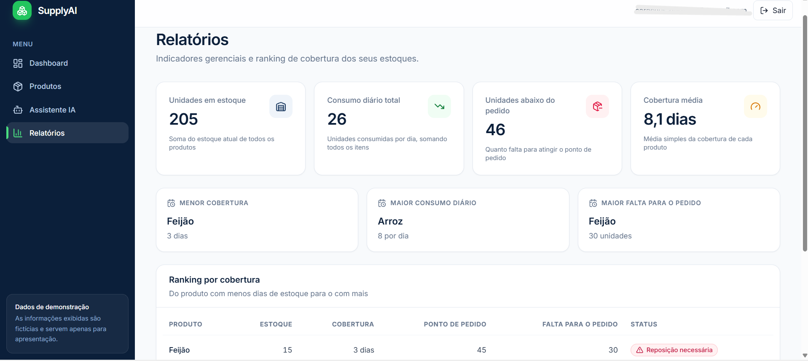
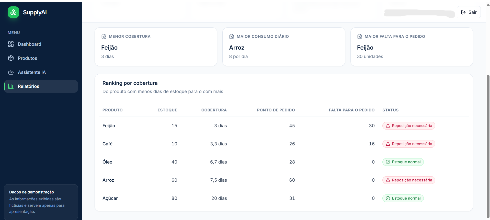
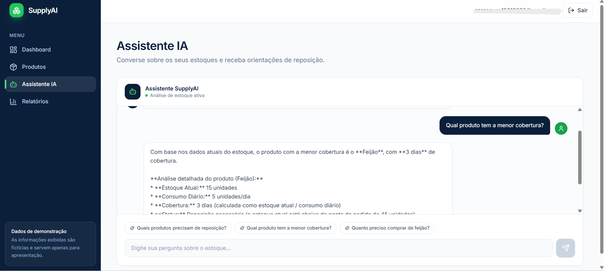

# SupplyAI — Assistente Inteligente de Gestão de Estoque

O **SupplyAI** é uma aplicação web desenvolvida para auxiliar no gerenciamento e na tomada de decisões relacionadas ao controle de estoque. O sistema combina indicadores de gestão de estoque com inteligência artificial para transformar dados operacionais em informações úteis para a tomada de decisão.

## Objetivo do projeto

Desenvolver uma ferramenta que facilite o acompanhamento dos níveis de estoque, identifique a necessidade de reposição de produtos e ofereça análises inteligentes para apoiar o planejamento de compras.

## Funcionalidades

- **Dashboard:** visualização de indicadores e informações gerais do estoque.
- **Gestão de produtos:** cadastro, consulta, edição e exclusão de produtos, conforme o nível de permissão do usuário.
- **Monitoramento de estoque:** identificação de produtos que necessitam de reposição.
- **Ponto de pedido:** cálculo baseado no consumo diário, prazo de entrega e estoque de segurança.
- **Cobertura de estoque:** estimativa de quantos dias o estoque disponível consegue atender à demanda.
- **Relatórios:** visualização de informações e indicadores relacionados ao estoque.
- **Assistente com inteligência artificial:** permite realizar perguntas sobre o estoque e receber respostas contextualizadas com base nos dados dos produtos.

## Indicadores e metodologia de cálculo

O SupplyAI utiliza parâmetros de gestão de estoque para monitorar os produtos e identificar necessidades de reposição.

### 1. Ponto de pedido

Indica o nível de estoque em que deve ser iniciada uma reposição.

**Fórmula:**

Ponto de Pedido = (Consumo Diário × Prazo de Entrega) + Estoque de Segurança

### 2. Cobertura de estoque

Estima por quantos dias o estoque disponível consegue atender ao consumo.

**Fórmula:**

Cobertura = Estoque Atual / Consumo Diário

### 3. Necessidade de reposição

Calcula a quantidade necessária para alcançar novamente o ponto de pedido quando o estoque está abaixo desse nível.

**Fórmula:**

Quantidade para Reposição = Ponto de Pedido - Estoque Atual

### Parâmetros utilizados

- Estoque atual;
- Estoque de segurança;
- Consumo médio diário;
- Prazo de entrega do fornecedor.

Esses indicadores permitem acompanhar a situação dos produtos, antecipar necessidades de compra e apoiar a tomada de decisão.

## Tecnologias utilizadas

- React
- TypeScript
- Vite
- Tailwind CSS
- Supabase
- Supabase Auth
- Supabase Edge Functions
- Google Gemini API

## Inteligência artificial

O SupplyAI possui um assistente inteligente integrado ao Google Gemini, responsável por interpretar perguntas relacionadas ao estoque e gerar respostas com base nos dados disponíveis no sistema.

A integração utiliza uma Supabase Edge Function, que processa as solicitações e consulta as informações necessárias antes de gerar a resposta.

## Segurança e controle de acesso

O sistema utiliza autenticação pelo Supabase e políticas de Row Level Security (RLS) para controlar o acesso aos dados.

As permissões são configuradas para permitir a consulta dos produtos por usuários autenticados, enquanto as operações de cadastro, edição e exclusão são restritas ao administrador.

## Conceitos de Engenharia de Produção aplicados

O desenvolvimento do SupplyAI envolve conceitos relacionados a:

- Gestão e controle de estoques;
- Estoque de segurança;
- Ponto de pedido;
- Consumo médio diário;
- Prazo de reposição;
- Planejamento de compras;
- Análise de indicadores;
- Apoio à tomada de decisão.

## Objetivo como projeto de portfólio

O SupplyAI foi desenvolvido como projeto de portfólio, com o propósito de aplicar conhecimentos de Engenharia de Produção, análise de dados e desenvolvimento de soluções tecnológicas em um problema real da gestão de operações.

---

**Desenvolvido como projeto de portfólio em Engenharia de Produção.**
## Demonstração da aplicação

### Dashboard

### Gestão de produtos

### Relatórios

### Assistente inteligente
